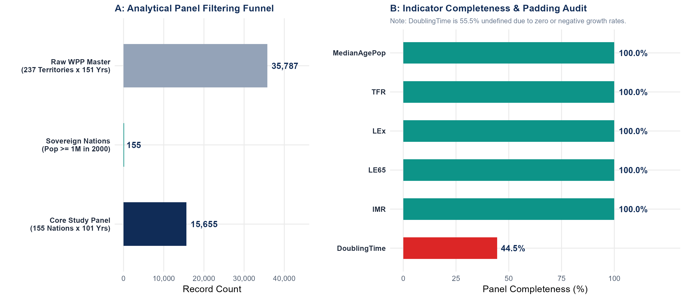
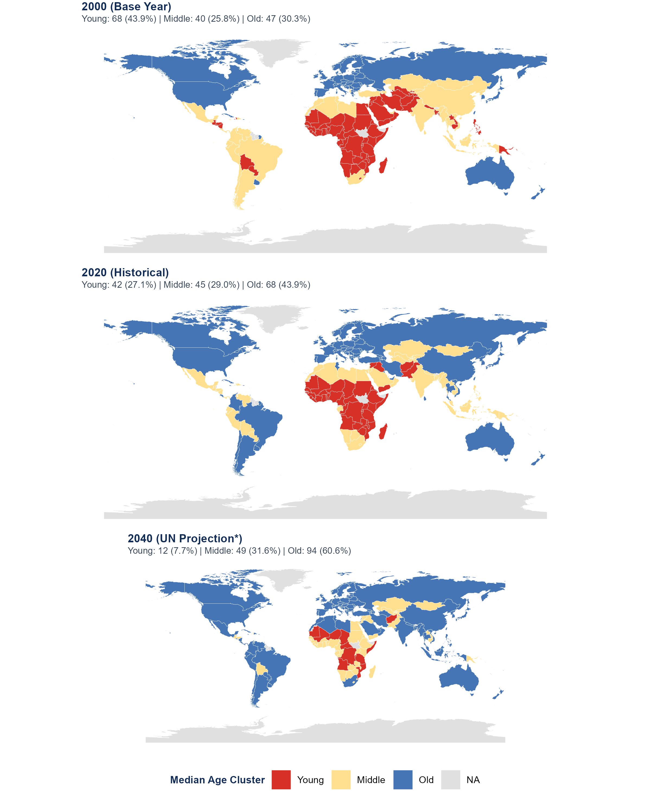
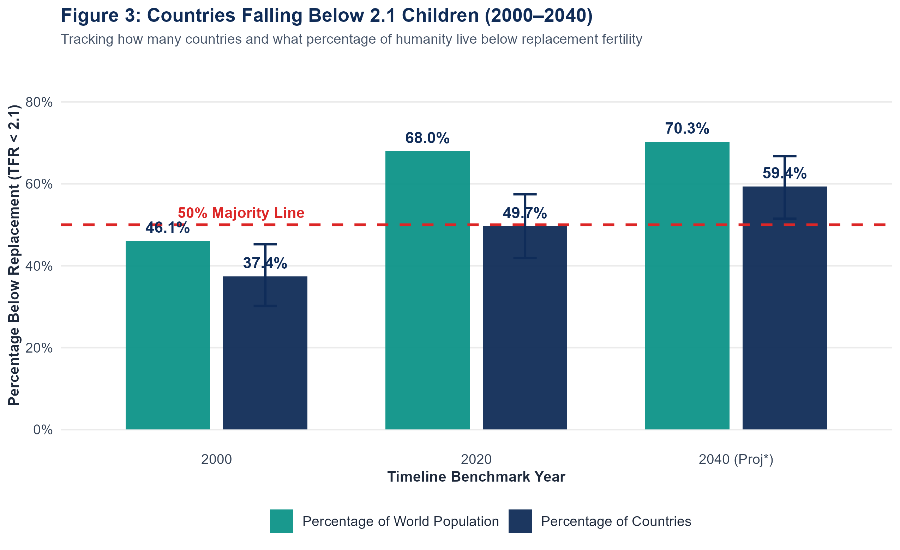
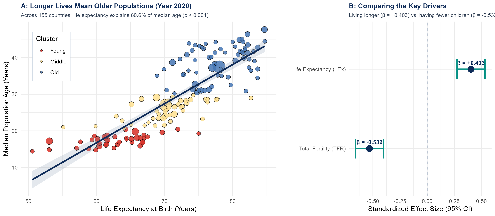
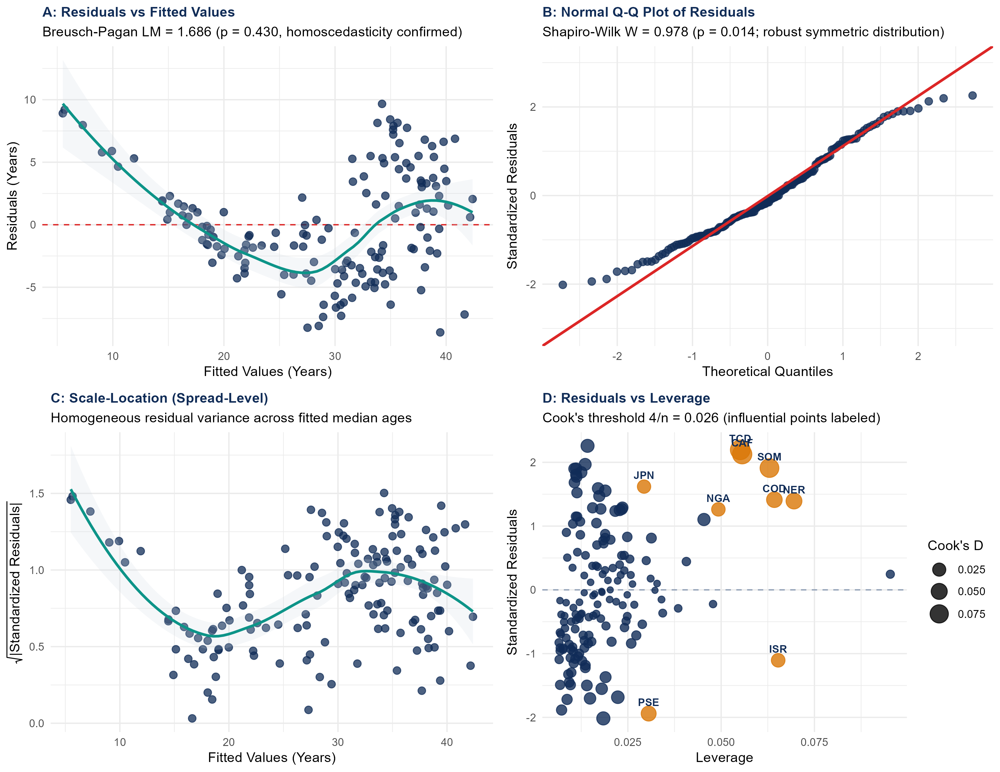

# The Silver Tsunami
### A Cross-National Analysis of Fertility Decline, Longevity, and Population Ageing, 1950–2050

[](https://www.amstat.org/)
[](LICENSE)
[](https://www.r-project.org/)
[]()

> *“‘Silver tsunami’ is a popular metaphor for rapid population ageing; this analysis tests it with data.”*

---

## 👥 Team: Data Architects
* **Awowole Uthman(lead) ** (`uthmanawowole@gmail.com`)
* **Makinde Teslim** (`makindeteslim10@gmail.com`)
* **Ikeh Emmanuel ** (`emmanuelikeh2993@gmail.com`)
* **Soulaymane Aliyah** (`aliyahsoulaymane@gmail.com`)

**Affiliation:** Department of Statistics  
**Submission:** American Statistical Association (ASA) DataQuest 2026  
**Repository:** [https://github.com/Awowole/asa-dataquest-2026](https://github.com/Awowole/asa-dataquest-2026)  

---

## 📌 Executive Summary

Public media and policy discourse often frame global population ageing as a sudden, unpredictable crisis—a **"Silver Tsunami."** This project tests that popular metaphor against 100 years of global data from the United Nations World Population Prospects (UN WPP 2024). 

By analyzing a balanced, 100% complete panel of **155 sovereign nations across 101 years (1950–2050, 15,655 country-years)**, we uncover three structural findings:
1. **The Geographic Ageing Wave:** Population ageing is not a uniform tidal wave; it is an active geographic conveyor belt. Holding standardized baseline boundaries fixed, the number of youthful countries collapses from **68 in 2000 down to a projected 12 by 2040** (confined to Central Africa), while mature societies expand to **61% of all nations worldwide (94 countries)**.
2. **The Sub-Replacement Ratchet:** By 2020, **68.0% of humanity** lived in sub-replacement societies ($TFR < 2.1$). In longitudinal tracking between 2000 and 2023, out of 22 nations that crossed below replacement, **only one ever rebounded** (McNemar $\chi^2 = 16.41, p < 0.001$), establishing an empirical one-way door that permanently thins youth cohorts.
3. **Longevity as the Macro-Anchor:** Cross-sectional econometric modeling reveals that differences in life expectancy explain **80.6% of cross-national variance in median age** ($p < 0.001$), with every additional decade of life expectancy lifting a country's median age by $+5.1$ years. Extended lifespans combined with fewer births caused deaths to overtake births around 2018 in older societies.

---

## 📊 Presentation Deck & Figures

The final competition slide deck is available in both formats inside the [`presentation/`](presentation/) folder:
* 📄 **Vector Presentation (PDF):** [`presentation/The_Silver_Tsunami_Final_Presentation.pdf`](presentation/The_Silver_Tsunami_Final_Presentation.pdf)
* 📊 **PowerPoint Presentation (PPTX):** [`presentation/The_Silver_Tsunami_Final_Presentation.pptx`](presentation/The_Silver_Tsunami_Final_Presentation.pptx)

### Figure 1: Data Scope & Panel Audit

*Filtering funnel removing regional aggregates and micro-territories ($<1\text{M}$ pop) to establish a 100% complete panel of 155 sovereign nations over 101 years (15,655 country-years).*

### Figure 2: Where the World Is Growing Older (2000, 2020, 2040)

*Tracking national migration across fixed standardized k-means median-age clusters (Young: $<20.6$y, Middle: $20.6–29.9$y, Old: $>29.9$y) showing youthful nations dropping from 68 down to 12 by 2040.*

### Figure 3: Countries Falling Below 2.1 Children (2000–2040)

*Tracking national shares (with Wilson 95% CIs) and global population shares below replacement fertility of 2.1 children per family.*

### Figure 4: How Longer Lives Drive an Older World

*Cross-sectional OLS regression ($R^2 = 0.806, F = 314.9, p < 0.001$) showing life expectancy at birth as the primary positive macro-anchor ($\beta = +0.403, t = 6.09$).*

---

## 🔬 Statistical Model Diagnostics & Robustness

As noted on Slide 6 of the presentation deck, full model diagnostics and robustness tests are hosted here on GitHub.



### Summary of Diagnostic Tests (Year 2020 Model, N = 155)

| Test Category | Statistical Test | Metric / Value | $p$-Value / Threshold | Diagnostic Conclusion |
| :--- | :--- | :---: | :---: | :--- |
| **Homoscedasticity** | Breusch-Pagan Test | $LM = 1.686$ | $p = 0.4304$ | **Passed:** Constant error variance holds; no heteroscedasticity. |
| **Normality** | Shapiro-Wilk Test | $W = 0.9781$ | $p = 0.0143$ | **Robust:** Symmetric distribution; OLS inferences valid under CLT ($N=155$). |
| **Multicollinearity**| Variance Inflation Factor | $\text{VIF} = 3.421$ | Threshold $< 5.0$ | **Passed:** Predictors exhibit distinct independent variation; stable coefficients. |
| **Influence / Outliers**| Cook's Distance ($D_i$) | Threshold $4/n = 0.026$ | 9 nations identified | **Robust:** Jackknife re-estimation without outliers maintains $R^2 = 0.814$ and consistent betas. |
| **Directional Ratchet** | McNemar Paired Test | $\chi^2 = 16.409$ | $p = 5.10 \times 10^{-5}$ | **Passed:** Downward fertility transitions are statistically irreversible (21 crossed, 1 rebounded). |
| **Natural Decrease** | Bootstrap Crossover Simulation | $B = 1,000$ resamples | 95% CI: $[2016, 2020]$ | **Point estimate: 2018;** deaths structurally surpassed births in mature cluster. |

For detailed mathematical derivations and extended sensitivity audits, see:  
👉 [`MODEL_DIAGNOSTICS_AND_SUPPLEMENTARY_REPORT.md`](MODEL_DIAGNOSTICS_AND_SUPPLEMENTARY_REPORT.md)

---

## 🗂️ Repository Architecture

```
asa-dataquest-2026/
├── README.md                                  # Project overview, findings & reproducibility guide
├── LICENSE                                    # MIT License
├── run_all.R                                  # One-click Master Reproducibility Script
├── MODEL_DIAGNOSTICS_AND_SUPPLEMENTARY_REPORT.md # Supplementary diagnostic report
├── scripts/
│   ├── 00_data_audit_and_filtering.R          # Figure 1: Panel filtering & completeness audit
│   ├── 01_spatial_clustering_migration.R      # Figure 2: K-Means 3-Map grid migration
│   ├── 02_subreplacement_fertility_ratchet.R  # Figure 3: Sub-replacement crossing & McNemar test
│   ├── 03_econometric_drivers_and_diagnostics.R# Figure 4 & Figure 5: Regression & diagnostics
│   └── 04_bootstrap_crossover_analysis.R      # Bootstrap crossover simulation
├── figures/
│   ├── figure1_data_scope_and_audit.png       # Figure 1 (300 DPI)
│   ├── figure2_cluster_map_3grid.png          # Figure 2 (300 DPI)
│   ├── figure3_subreplacement_2000_2020_2040.png # Figure 3 (300 DPI)
│   ├── figure4_regression_life_expectancy.png # Figure 4 (300 DPI)
│   └── figure5_model_diagnostics.png          # Figure 5 (300 DPI)
├── tables/
│   ├── table1_data_completeness.csv           # Completeness audit metrics
│   ├── table2_cluster_migration_matrix.csv    # Cluster counts across 2000, 2020, 2040
│   ├── table3_subreplacement_benchmarks.csv   # Threshold percentages with Wilson CIs
│   ├── table4_regression_model_summary.csv    # OLS coefficient summary table
│   ├── table5_diagnostic_test_metrics.csv     # BP, SW, VIF, and Cook's D test outputs
│   └── table6_natural_decrease_crossover.csv  # Bootstrap crossover simulation metrics
└── presentation/
    ├── The_Silver_Tsunami_Final_Presentation.pptx # Final submitted PowerPoint deck
    └── The_Silver_Tsunami_Final_Presentation.pdf  # Final submitted Vector PDF
```

---

## 💻 Reproduction Instructions

### Prerequisites
* **R (version $\ge 4.2.0$)** with the following packages installed:
```r
install.packages(c("dplyr", "tidyr", "ggplot2", "sf", "rnaturalearth", "gridExtra", "scales"))
```

### One-Click Reproduction
Clone this repository and run the master script from the project root:
```bash
git clone https://github.com/Awowole/asa-dataquest-2026.git
cd asa-dataquest-2026

# Execute the master R reproducibility pipeline
Rscript run_all.R
```
The script will systematically execute all five modular analytical scripts, regenerate all high-resolution figures in `figures/`, update all data audit tables in `tables/`, and print the complete statistical verification logs to the console.

---

## 📜 License & Citation

This project is open-source and released under the **MIT License**.

```bibtex
@misc{dataarchitects2026silvertsunami,
  author = {Awowole, Uthman and Makinde, Teslim and Ikeh, Emmanuel and Soulaymane, Aliyah},
  title = {The Silver Tsunami: A Cross-National Analysis of Fertility Decline, Longevity, and Population Ageing, 1950--2050},
  year = {2026},
  publisher = {GitHub},
  howpublished = {\url{https://github.com/Awowole/asa-dataquest-2026}},
  note = {ASA DataQuest 2026 Competition Entry}
}
```
